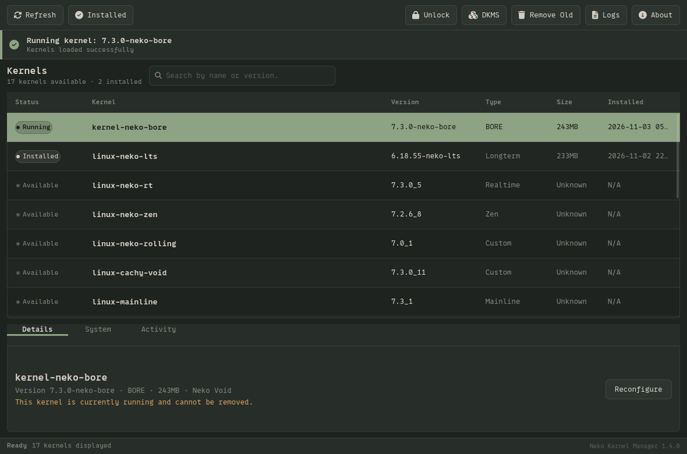
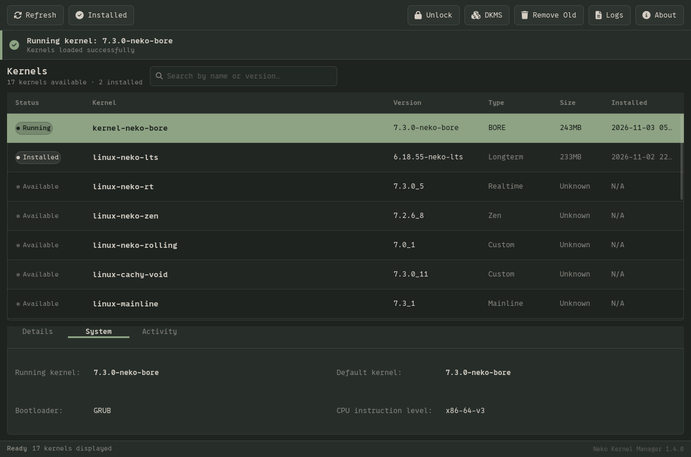
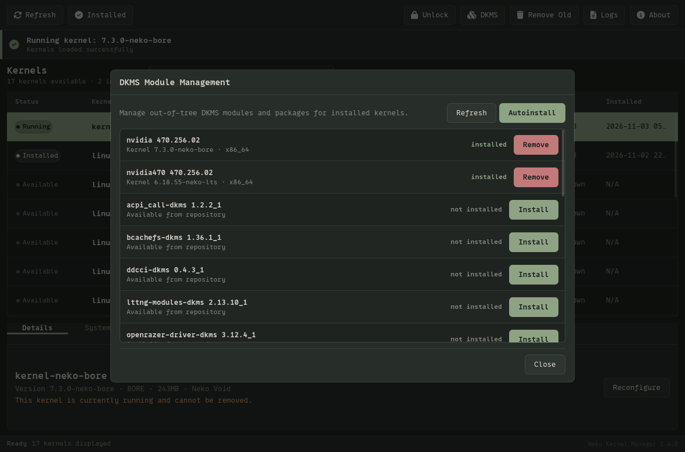
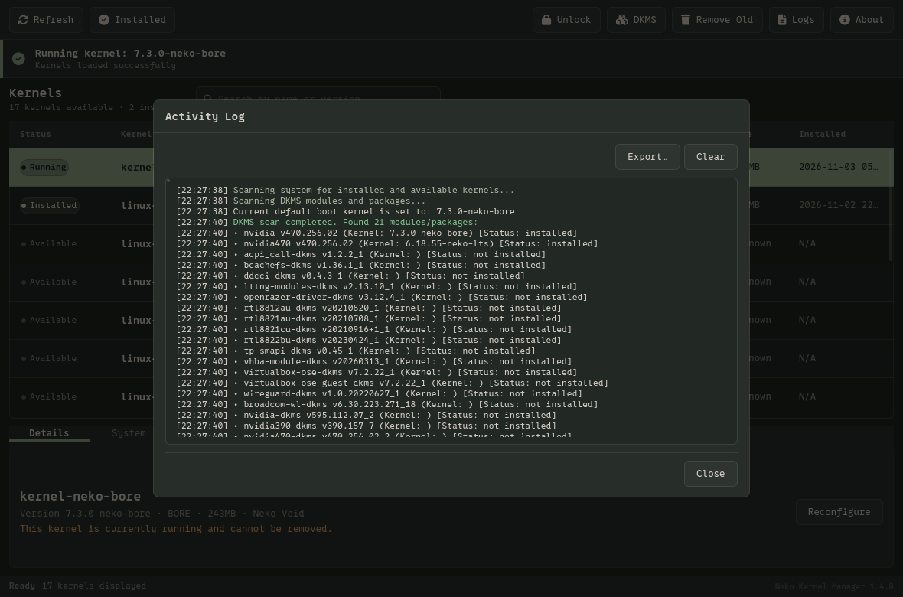
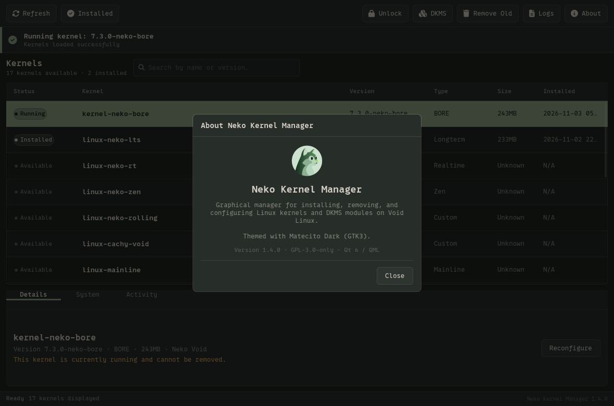

# Neko Kernel Manager

<p align="center">
  
</p>

<p align="center">
  <strong>A modern, reliable Linux kernel and DKMS manager for Void Linux.</strong>
</p>

<p align="center">
  <a href="https://github.com/ANOMALI0x00/Neko-Kernel-Manager/releases"></a>
  <a href="LICENSE"></a>
  
  
</p>

---

## Overview

**Neko Kernel Manager** is a native graphical kernel manager crafted specifically for **Void Linux**. Built with modern **C++20** and **Qt6 (QML/Quick)**, it features a bespoke GTK3-inspired *Matecito Dark* interface that renders consistently across any desktop environment (KDE, XFCE, GNOME, Sway, Hyprland, etc.).

Whether you are running official Void kernels, custom BORE/Zen builds from Neko Void, or self-compiled kernels in `/boot`, Neko Kernel Manager provides unified detection, safe installation, reconfiguration, DKMS module handling, and bootloader management.

---

## Screenshots

<p align="center">
  
</p>
<p align="center">
  <em>Main kernel overview: Status badges (Running / Default / Installed), repository detection, kernel actions, and instant filtering.</em>
</p>

<br>

<p align="center">
  
</p>
<p align="center">
  <em>System tab: Active and default GRUB kernel, bootloader, and detected CPU instruction level.</em>
</p>

<br>

<p align="center">
  
</p>
<p align="center">
  <em>DKMS Module Management: Manage installed out-of-tree modules and install available repository DKMS packages.</em>
</p>

<br>

<p align="center">
  
</p>
<p align="center">
  <em>Activity Log dialog: Real-time timestamped execution terminal with syntax highlighting and log export.</em>
</p>

<br>

<p align="center">
  
</p>
<p align="center">
  <em>About dialog: Application info and Matecito Dark theme integration.</em>
</p>

---

## Features

### Comprehensive Kernel Management
- **Void Linux XBPS Integration**: Seamlessly browse, install, and remove official Void kernels (`linux`, `linux-lts`, `linux-mainline`, etc.) and community repositories (Neko Void BORE/Zen, CachyOS, local repos).
- **Intelligent Metapackage Resolution**: Automatically de-duplicates Void metapackages (`linux` vs `linux6.18`) to avoid redundant entries in the UI.
- **`vkpurge` Orphan Detection**: Automatically detects obsolete kernel versions left behind by previous updates and safely removes them via `vkpurge`.
- **Manual `/boot` Kernel Detection**: Accurately recognizes user-compiled kernels (`make install`), manages their boot files (`vmlinuz`, `initramfs`, `System.map`, `modules`), and handles their removal.
- **Kernel Reconfiguration**: Re-run post-install dracut hooks and regenerate initramfs images directly with a single click.

### Out-of-Tree DKMS Module Management
- Scan and monitor installed vs. available DKMS packages (`nvidia`, `virtualbox-ose`, `broadcom-wl`, `wireguard`, etc.).
- Build and install modules for specific installed kernels.
- Automated `dracut` initramfs regeneration after compiling kernel modules.

### Bootloader & System Integration
- **GRUB Boot Management**: Set the active default boot kernel with persistent `GRUB_DEFAULT=saved` support.
- **Automatic Configuration Update**: Safely runs `grub-mkconfig` after any kernel installation, reconfigure, or removal.
- **Architecture Level Detection**: Inspect CPU microarchitecture levels (`x86-64-v2`, `v3`, `v4`) and active bootloader type.

### Security & Single Authentication
- **Dedicated Polkit Helper**: Root actions run through `/usr/libexec/neko-kernel-manager/neko-kernel-helper` guarded by PolicyKit (`org.nekovoid.NekoKernelManager.policy`).
- **No Repeated Password Prompts**: Configured with `auth_admin_keep` so administrative privileges are retained for the session duration.
- **Safety Locks**:
  - Strictly prevents removing the kernel currently running (`uname -r`).
  - Blocks deletion if only one functional kernel remains installed.
  - Rigorous input sanitization prevents command injection and path traversal (`..`).

### Visuals & Logging
- **Matecito Dark Theme**: Consistent GTK3-styled appearance enforced across all environments.
- **Real-Time Activity Terminal**: Monitored execution logs with RichText syntax highlighting and log export functionality.

---

## Requirements

- **Operating System**: Void Linux (x86_64 / x86_64-musl)
- **C++ Compiler**: GCC 11+ or Clang 13+ (with C++20 support)
- **Build System**: CMake (>= 3.16) or Meson (>= 0.59) + Ninja / Make
- **Qt6 Packages**:
  - `qt6-base`, `qt6-declarative`, `qt6-quickcontrols2`
- **System Utilities**:
  - `xbps`
  - `dracut`
  - `polkit` / `pkexec`
  - `vkpurge` (optional, for orphan cleanup)
  - `dkms` (optional, for module management)

---

## Building and Installation

### 1. Install Dependencies on Void Linux
```bash
sudo xbps-install -S base-devel cmake qt6-base-devel qt6-declarative-devel
```

### 2. Clone the Repository
```bash
git clone https://github.com/ANOMALI0x00/Neko-Kernel-Manager.git
cd Neko-Kernel-Manager
```

### 3. Build with CMake
```bash
cmake -B build -DCMAKE_BUILD_TYPE=Release
cmake --build build -j$(nproc)
```

*(Alternatively, build using Meson: `meson setup build --buildtype=release && meson compile -C build`)*

### 4. Install Helper & Policy (Required for Single Password Escalation)
```bash
sudo mkdir -p /usr/libexec/neko-kernel-manager
sudo cp helper/neko-kernel-helper /usr/libexec/neko-kernel-manager/
sudo chmod 755 /usr/libexec/neko-kernel-manager/neko-kernel-helper
sudo cp policy/org.nekovoid.NekoKernelManager.policy /usr/share/polkit-1/actions/
```

### 5. Run
```bash
./build/neko-kernel-manager
```

---

## License

This project is licensed under the **GNU General Public License v3.0 (GPL-3.0)**. See the [LICENSE](LICENSE) file for details.
